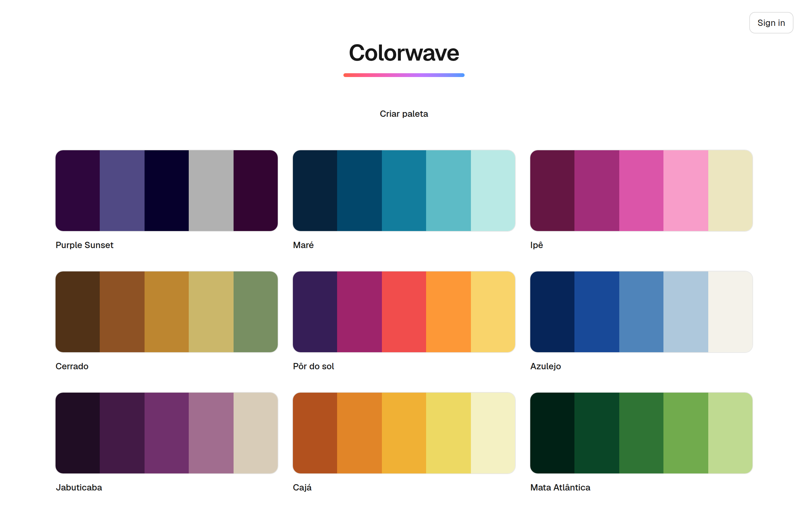
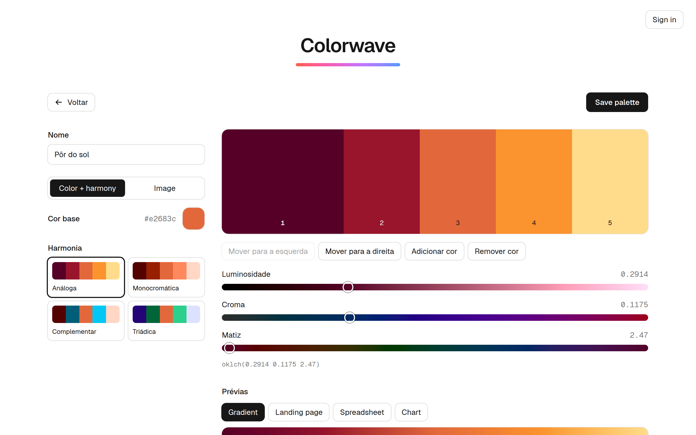

<p align="center">
  
</p>

<p align="center">
  Crie e compartilhe paletas de cores, a partir de uma harmonia ou de uma imagem.
</p>

<p align="center">
  <a href="https://colorwave.vercel.app"></a>
  
  
  
  
  
  
</p>

<table>
  <tr>
    <td></td>
    <td></td>
  </tr>
</table>

## O que faz

- **Editor em OKLCH**: parte de uma cor base e uma harmonia (análoga, monocromática, complementar, triádica) ou extrai as cores de uma imagem enviada.
- **Ajuste fino** de luminosidade, croma e matiz, com aviso de cores fora de sRGB.
- **Prévias** da paleta num gradiente, numa landing page, numa planilha e num gráfico.
- **Galeria pública**: as paletas nascem privadas e são publicadas quando o autor quiser.

## Rodando localmente

Requer Node 24 (`nvm use`). Crie um `.env.local` apontando para uma branch de desenvolvimento do Neon, nunca a de produção:

```bash
DATABASE_URL="string com pooling, usada pelo app"
DATABASE_URL_UNPOOLED="string sem pooling, usada nas migrações"
DATABASE_NEON_AUTH_BASE_URL="URL de Auth da mesma branch do Neon"
NEON_AUTH_COOKIE_SECRET="saída de: openssl rand -base64 32"
```

```bash
npm install
npm run db:migrate
npm run dev      # http://localhost:3000
npm test
```

Depois de alterar `src/db/schema.ts`, rode `npm run db:generate` e `npm run db:migrate`. O `npm run build` aplica as migrações pendentes, então cada deploy na Vercel migra o banco do próprio ambiente. Lá, as três primeiras variáveis vêm da integração com o Neon. O `NEON_AUTH_COOKIE_SECRET` é criado à mão, com um valor diferente do local.
